# **Instalación de CMS en Alta Disponibilidad**
##### _Amparo Sánchez Ledo - ASIR 2 - 21/11/2026_

En esta práctica desplegamos **[WordPress](https://es.wordpress.org/)** en **Alta Disponibilidad** sobre 8 máquinas virtuales **[Debian 12](https://www.debian.org/)** organizadas en **4 capas** dentro de una red interna aislada (**`intnet`**), de modo que el sitio siga operativo aunque caiga un servidor web o un nodo de base de datos:

- **Capa 1 — Balanceador de carga (Nginx)**: Única máquina expuesta al exterior (`localhost:8080`). Reparte el tráfico entre los servidores web y deja de enviar peticiones al que caiga.
- **Capa 2 — Backend (2 Nginx + 1 NFS/PHP-FPM)**: Los dos servidores web montan **WordPress** por **NFS** desde **`serverNFSAmparo`** y le delegan la ejecución de **[PHP](https://www.php.net/)** mediante **socket TCP**.
- **Capa 3 — Balanceador de BD (HAProxy)**: Intermediario entre **WordPress** y la base de datos. Reparte las conexiones entre los nodos activos del clúster.
- **Capa 4 — Clúster de datos ([MariaDB Galera](https://mariadb.com/docs/galera-cluster))**: Tres nodos **[MariaDB](https://mariadb.org/)** sincronizados (*multi-master*). Si un nodo cae, el clúster sigue trabajando y se resincroniza al volver a arrancar.

---

## **_Índice de contenidos_**

- 0. **[Requisitos previos](#0-requisitos-previos)**
- 1. **[Preparación del entorno](#1-preparación-del-entorno)**
  - 1.1 [Creación del fichero `.gitignore`](#11-creación-del-fichero-gitignore)
  - 1.2 [Estructura de carpetas](#12-estructura-de-carpetas)
  - 1.3 [Variables de entorno (`.env.example` y `.env`)](#13-variables-de-entorno-envexample-y-env)
  - 1.4 [Configuración del `Vagrantfile`](#14-configuración-del-vagrantfile)
- 2. **[Scripts de aprovisionamiento](#2-scripts-de-aprovisionamiento)**
  - 2.1 [Clúster MariaDB Galera (`galera.sh`)](#21-clúster-mariadb-galera-galerash)
  - 2.2 [Balanceador de base de datos HAProxy (`haproxy.sh`)](#22-balanceador-de-base-de-datos-haproxy-haproxysh)
  - 2.3 [Servidor NFS y PHP-FPM (`nfs_php.sh`)](#23-servidor-nfs-y-php-fpm-nfs_phpsh)
  - 2.4 [Servidores web Nginx (`web.sh`)](#24-servidores-web-nginx-websh)
  - 2.5 [Balanceador de carga Nginx (`balanceador.sh`)](#25-balanceador-de-carga-nginx-balanceadorsh)
- 3. **[Despliegue y comprobaciones](#3-despliegue-y-comprobaciones)**
  - 3.1 [Despliegue de la infraestructura](#31-despliegue-de-la-infraestructura)
  - 3.2 [Comprobaciones](#32-comprobaciones)
- 4. **[Volver a arrancar Galera tras un apagado](#4-volver-a-arrancar-galera-tras-un-apagado)**
- 5. **[Screencast](#5-screencast)**
- 6. **[Incidencias](#6-incidencias)**
- 7. **[Fuentes consultadas](#7-fuentes-consultadas)**

---

## **_0. Requisitos previos_**

- **[VirtualBox](https://www.virtualbox.org/)**, **[Vagrant](https://developer.hashicorp.com/vagrant)** y **[Git](https://git-scm.com/)** para clonar y desplegar el entorno.
- **[VS Code](https://code.visualstudio.com/)** (o cualquier editor) para crear `.env` a partir de `.env.example`.
- **Navegador web** (`http://localhost:8080`) y al menos **6 GB de RAM libres** en el anfitrión.

> **Recordatorio**: Cambiar el sufijo `Amparo` si se despliega con otro usuario. Si el equipo va justo de RAM, los tres nodos Galera pueden bajarse a **768 MB**.

| Orden | Capa | Nombre de la máquina | Papel | IP Interna | RAM |
| :---: | :---: | :--- | :--- | :---: | :---: |
| 1 | 4 | `serverdatosAmparo` | Nodo 1 MariaDB Galera | `192.168.10.41` | 1024 MB |
| 2 | 4 | `serverdatos2Amparo` | Nodo 2 MariaDB Galera | `192.168.10.42` | 1024 MB |
| 3 | 4 | `serverdatos3Amparo` | Nodo 3 MariaDB Galera | `192.168.10.43` | 1024 MB |
| 4 | 3 | `proxyBBDDAmparo` | HAProxy (balanceador BD) | `192.168.10.30` | 512 MB |
| 5 | 2 | `serverNFSAmparo` | Servidor NFS + PHP-FPM + WordPress | `192.168.10.20` | 512 MB |
| 6 | 2 | `serverweb1Amparo` | Servidor web Nginx 1 | `192.168.10.21` | 512 MB |
| 7 | 2 | `serverweb2Amparo` | Servidor web Nginx 2 | `192.168.10.22` | 512 MB |
| 8 | 1 | `balanceadorAmparo` | Balanceador Nginx (puerto `8080`) | `192.168.10.10` | 512 MB |

---

## **_1. Preparación del entorno_**

Inicializamos el proyecto con **Debian 12** para generar el **`Vagrantfile`** base:

```bash
vagrant init debian/bookworm64
```

### **_1.1 Creación del fichero `.gitignore`_**

Excluye las credenciales reales (**`.env`**) y archivos temporales del repositorio:

<details>
  <summary>
    <strong>
      Ver código <code>.gitignore</code>
    </strong>
  </summary>

```gitignore
# Variables sensibles (nunca subir contraseñas reales)
.env

# Archivos temporales de Vagrant y VirtualBox
.vagrant/
*.log

# Archivos del sistema operativo
.DS_Store
Thumbs.db
```

</details>

---

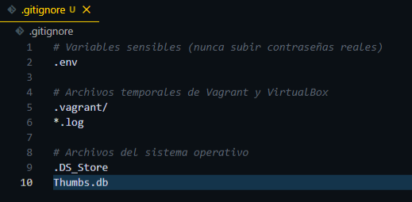

### **_1.2 Estructura de carpetas_**

Organizamos el repositorio con sus archivos de configuración y carpetas **`provision/`** (scripts), **`img/`** (capturas) y **`screencast/`** (vídeo):

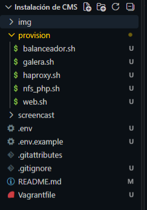

### **_1.3 Variables de entorno (`.env.example` y `.env`)_**

Centralizamos IPs, credenciales y parámetros de **WordPress** en **`.env`** (ignorado por Git) usando **`.env.example`** como plantilla:

<details>
  <summary>
    <strong>
      Ver código <code>.env.example</code>
    </strong>
  </summary>

> **Nota:** Copiar a `.env` y sustituir las credenciales de ejemplo antes de ejecutar `vagrant up`.

```env
# Direccionamiento IP de la red interna (intnet)
IP_DB1=192.168.10.41
IP_DB2=192.168.10.42
IP_DB3=192.168.10.43
IP_HAPROXY=192.168.10.30
IP_NFS=192.168.10.20
IP_WEB1=192.168.10.21
IP_WEB2=192.168.10.22
IP_LB=192.168.10.10

# Clúster MariaDB Galera y base de datos
CLUSTER_NAME=galera_cluster
DB_NAME=wordpress
DB_USER=wp_user
DB_PASS=UsuarioBD123!
HAPROXY_CHECK_USER=haproxy_check

# Configuración de WordPress
WP_URL=http://localhost:8080
WP_TITLE="WordPress HA de Usuario"
WP_LOCALE=es_ES
WP_ADMIN_USER=usuario_admin
WP_ADMIN_PASS=UsuarioAdmin123!
WP_ADMIN_EMAIL=admin@usuario.com
WP_THEME=astra
```

> **EXPLICACIÓN DEL CÓDIGO**
> ---
> - **`IP_*`**: IPs estáticas de las 8 máquinas en `192.168.10.0/24`.
> - **`CLUSTER_NAME`, `DB_*` y `HAPROXY_CHECK_USER`**: Clúster Galera, credenciales de WordPress (solo desde HAProxy) y usuario para *healthchecks*.
> - **`WP_*`**: URL pública (`http://localhost:8080`), título, idioma, administrador y tema (`astra`).

</details>

---

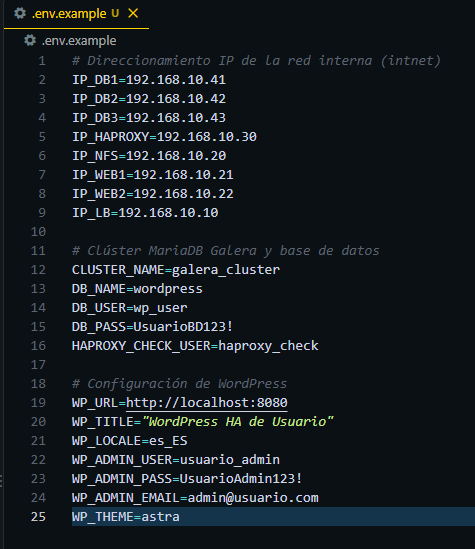

### **_1.4 Configuración del `Vagrantfile`_**

Define las 8 máquinas en orden ascendente sobre la red interna **`red_lemp_ha`**, exponiendo solo el puerto **`8080`** en **`balanceadorAmparo`**:

<details>
  <summary>
    <strong>
      Ver código <code>Vagrantfile</code>
    </strong>
  </summary>

```ruby
Vagrant.configure("2") do |config|
  # Imagen base común para las 8 máquinas (Debian 12)
  config.vm.box = "debian/bookworm64"

  # ----------------------------------------------------------------------------
  # CAPA 4: Clúster MariaDB Galera (3 nodos)
  # ----------------------------------------------------------------------------
  config.vm.define "serverdatosAmparo" do |node|
    node.vm.hostname = "serverdatosAmparo"
    node.vm.network "private_network", ip: "192.168.10.41", virtualbox__intnet: "red_lemp_ha"
    node.vm.provider "virtualbox" do |vb|
      vb.name = "serverdatosAmparo"
      vb.memory = "1024"
      vb.cpus = 1
    end
    node.vm.provision "shell", path: "provision/galera.sh", args: ["192.168.10.41", "bootstrap"]
  end

  config.vm.define "serverdatos2Amparo" do |node|
    node.vm.hostname = "serverdatos2Amparo"
    node.vm.network "private_network", ip: "192.168.10.42", virtualbox__intnet: "red_lemp_ha"
    node.vm.provider "virtualbox" do |vb|
      vb.name = "serverdatos2Amparo"
      vb.memory = "1024"
      vb.cpus = 1
    end
    node.vm.provision "shell", path: "provision/galera.sh", args: ["192.168.10.42", "join"]
  end

  config.vm.define "serverdatos3Amparo" do |node|
    node.vm.hostname = "serverdatos3Amparo"
    node.vm.network "private_network", ip: "192.168.10.43", virtualbox__intnet: "red_lemp_ha"
    node.vm.provider "virtualbox" do |vb|
      vb.name = "serverdatos3Amparo"
      vb.memory = "1024"
      vb.cpus = 1
    end
    node.vm.provision "shell", path: "provision/galera.sh", args: ["192.168.10.43", "join"]
  end

  # ----------------------------------------------------------------------------
  # CAPA 3: Balanceador de base de datos HAProxy
  # ----------------------------------------------------------------------------
  config.vm.define "proxyBBDDAmparo" do |node|
    node.vm.hostname = "proxyBBDDAmparo"
    node.vm.network "private_network", ip: "192.168.10.30", virtualbox__intnet: "red_lemp_ha"
    node.vm.provider "virtualbox" do |vb|
      vb.name = "proxyBBDDAmparo"
      vb.memory = "512"
      vb.cpus = 1
    end
    node.vm.provision "shell", path: "provision/haproxy.sh"
  end

  # ----------------------------------------------------------------------------
  # CAPA 2: Servidor NFS + PHP-FPM + WordPress y 2 servidores web Nginx
  # ----------------------------------------------------------------------------
  config.vm.define "serverNFSAmparo" do |node|
    node.vm.hostname = "serverNFSAmparo"
    node.vm.network "private_network", ip: "192.168.10.20", virtualbox__intnet: "red_lemp_ha"
    node.vm.provider "virtualbox" do |vb|
      vb.name = "serverNFSAmparo"
      vb.memory = "512"
      vb.cpus = 1
    end
    node.vm.provision "shell", path: "provision/nfs_php.sh"
  end

  config.vm.define "serverweb1Amparo" do |node|
    node.vm.hostname = "serverweb1Amparo"
    node.vm.network "private_network", ip: "192.168.10.21", virtualbox__intnet: "red_lemp_ha"
    node.vm.provider "virtualbox" do |vb|
      vb.name = "serverweb1Amparo"
      vb.memory = "512"
      vb.cpus = 1
    end
    node.vm.provision "shell", path: "provision/web.sh"
  end

  config.vm.define "serverweb2Amparo" do |node|
    node.vm.hostname = "serverweb2Amparo"
    node.vm.network "private_network", ip: "192.168.10.22", virtualbox__intnet: "red_lemp_ha"
    node.vm.provider "virtualbox" do |vb|
      vb.name = "serverweb2Amparo"
      vb.memory = "512"
      vb.cpus = 1
    end
    node.vm.provision "shell", path: "provision/web.sh"
  end

  # ----------------------------------------------------------------------------
  # CAPA 1: Balanceador de carga Nginx (única máquina expuesta al anfitrión)
  # ----------------------------------------------------------------------------
  config.vm.define "balanceadorAmparo" do |node|
    node.vm.hostname = "balanceadorAmparo"
    node.vm.network "private_network", ip: "192.168.10.10", virtualbox__intnet: "red_lemp_ha"
    node.vm.network "forwarded_port", guest: 80, host: 8080
    node.vm.provider "virtualbox" do |vb|
      vb.name = "balanceadorAmparo"
      vb.memory = "512"
      vb.cpus = 1
    end
    node.vm.provision "shell", path: "provision/balanceador.sh"
  end
end
```

> **EXPLICACIÓN DEL CÓDIGO**
> ---
> - **`virtualbox__intnet: "red_lemp_ha"`**: Red interna aislada del anfitrión.
> - **Orden ascendente**: Cada capa encuentra operativos los servicios de la capa inferior.
> - **Un script por papel**: `galera.sh` (IP y rol) para los 3 nodos de datos y `web.sh` para ambos servidores web.
> - **`forwarded_port`**: Solo `balanceadorAmparo` expone `8080 → 80`.

</details>

---

| | |
| --- | --- |
| 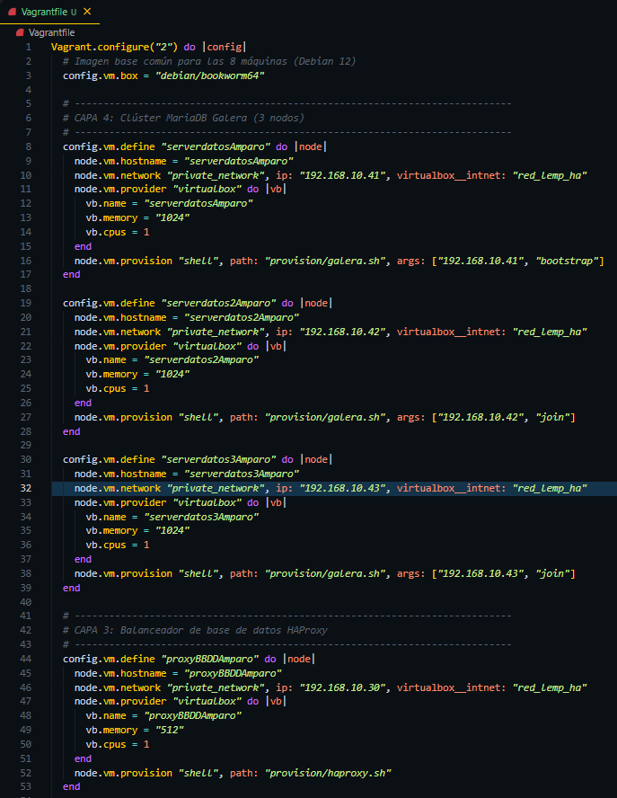 | 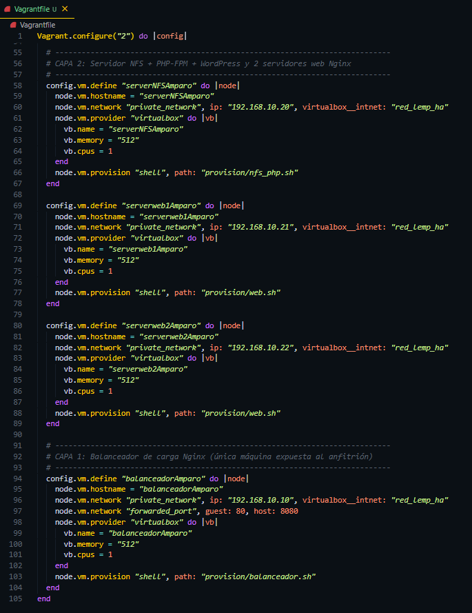 |

---

## **_2. Scripts de aprovisionamiento_**

Cinco scripts **Bash** idempotentes en **`provision/`** que cargan **`.env`** y automatizan todo el despliegue con `vagrant up`.

### **_2.1 Clúster MariaDB Galera (`galera.sh`)_**

Instala y configura **MariaDB + Galera 4** en los tres nodos de datos (`bootstrap` en el nodo 1 y `join` en los nodos 2 y 3):

<details>
  <summary>
    <strong>
      Ver código <code>galera.sh</code>
    </strong>
  </summary>

```bash
#!/usr/bin/env bash
# Script 1: Clúster MariaDB Galera (Capa 4 - Datos)
# Uso: galera.sh <IP_NODO> <bootstrap|join>
set -e

export DEBIAN_FRONTEND=noninteractive

NODE_IP="$1"
ROLE="$2"

# 1. Carga de variables de entorno
ENV_FILE="/vagrant/.env"
if [ ! -f "$ENV_FILE" ]; then
  ENV_FILE="/vagrant/.env.example"
fi

set -a
source <(tr -d '\r' < "$ENV_FILE")
set +a

# 2. Instalación de MariaDB Server, Galera 4 y rsync
echo ">>> Instalando MariaDB y Galera en $(hostname) ($NODE_IP)..."
apt-get update -y
apt-get install -y mariadb-server galera-4 rsync

# 3. Configuración de MariaDB en red interna y parámetros de Galera
echo ">>> Configurando Galera Cluster..."
cat > /etc/mysql/mariadb.conf.d/60-galera.cnf << EOF
[mysqld]
binlog_format=ROW
default-storage-engine=innodb
innodb_autoinc_lock_mode=2
bind-address=${NODE_IP}

wsrep_on=ON
wsrep_provider=/usr/lib/galera/libgalera_smm.so
wsrep_cluster_name="${CLUSTER_NAME}"
wsrep_cluster_address="gcomm://${IP_DB1},${IP_DB2},${IP_DB3}"
wsrep_node_address="${NODE_IP}"
wsrep_node_name="$(hostname)"
wsrep_sst_method=rsync
EOF

# 4. Arranque del clúster (idempotente)
CLUSTER_SIZE=$(mariadb -Nse "SHOW STATUS LIKE 'wsrep_cluster_size';" 2>/dev/null | awk '{print $2}' || echo "0")

if [ "$ROLE" = "bootstrap" ]; then
  if [ "$CLUSTER_SIZE" -eq 0 ]; then
    echo ">>> Inicializando el clúster Galera (bootstrap)..."
    systemctl stop mariadb || true
    galera_new_cluster
  else
    echo ">>> El clúster ya está activo en este nodo (tamaño: $CLUSTER_SIZE)."
  fi

  # Creación de la BD y usuarios restringidos exclusivamente a HAProxy
  echo ">>> Creando base de datos y usuarios restringidos a HAProxy ($IP_HAPROXY)..."
  mariadb -e "CREATE DATABASE IF NOT EXISTS \`${DB_NAME}\` CHARACTER SET utf8mb4 COLLATE utf8mb4_unicode_ci;
  CREATE USER IF NOT EXISTS '${DB_USER}'@'${IP_HAPROXY}' IDENTIFIED BY '${DB_PASS}';
  ALTER USER '${DB_USER}'@'${IP_HAPROXY}' IDENTIFIED BY '${DB_PASS}';
  GRANT ALL PRIVILEGES ON \`${DB_NAME}\`.* TO '${DB_USER}'@'${IP_HAPROXY}';
  CREATE USER IF NOT EXISTS '${HAPROXY_CHECK_USER}'@'${IP_HAPROXY}';
  FLUSH PRIVILEGES;"
else
  if [ "$CLUSTER_SIZE" -lt 2 ]; then
    echo ">>> Uniendo $(hostname) al clúster Galera..."
    systemctl stop mariadb || true
    systemctl start mariadb
  else
    echo ">>> El nodo ya forma parte del clúster (tamaño: $CLUSTER_SIZE)."
  fi
fi

systemctl enable mariadb
echo ">>> Nodo Galera $(hostname) configurado correctamente."
```

> **EXPLICACIÓN DEL CÓDIGO**
> ---
> - **Parámetros `$1` y `$2`**: IP interna y rol (`bootstrap` o `join`) desde el `Vagrantfile`.
> - **`60-galera.cnf`**: Escucha solo en `NODE_IP`, enlaza los 3 nodos (`gcomm://...`) y sincroniza con `rsync`.
> - **Idempotencia**: Comprueba `wsrep_cluster_size` antes de reiniciar o inicializar el clúster.
> - **Seguridad**: `DB_USER` y `HAPROXY_CHECK_USER` solo aceptan conexiones desde `192.168.10.30` (HAProxy).

</details>

---

| | |
| --- | --- |
| 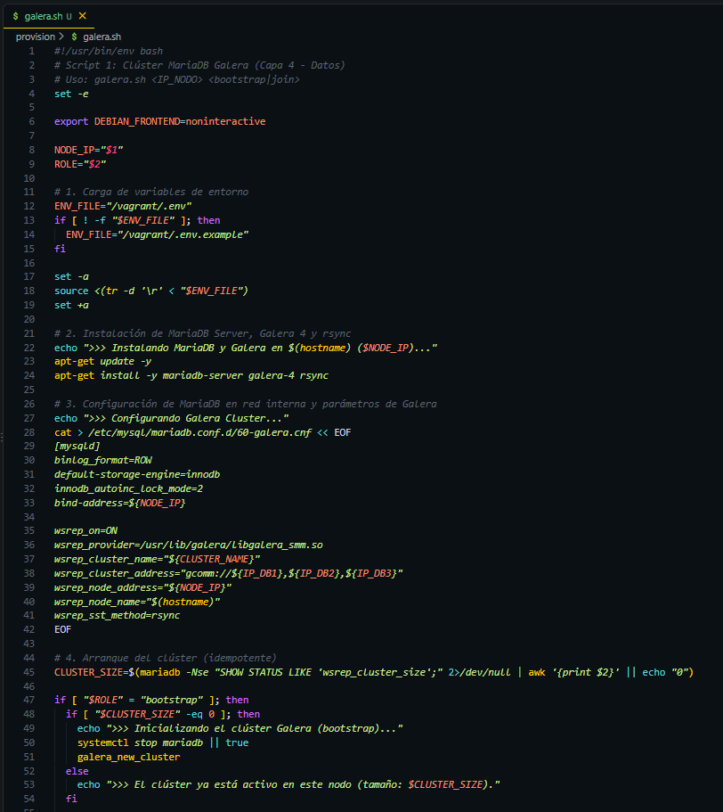 | 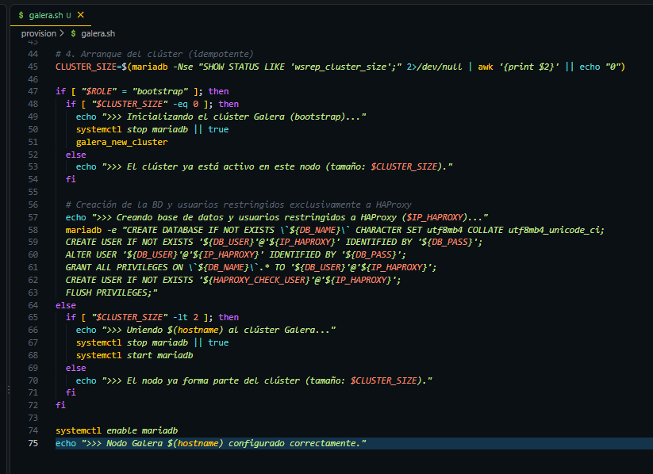 |

### **_2.2 Balanceador de base de datos HAProxy (`haproxy.sh`)_**

Configura **HAProxy** en **`proxyBBDDAmparo`** (`192.168.10.30:3306`) para balancear y monitorizar los tres nodos Galera:

<details>
  <summary>
    <strong>
      Ver código <code>haproxy.sh</code>
    </strong>
  </summary>

```bash
#!/usr/bin/env bash
# Script 2: Balanceador de base de datos HAProxy (Capa 3)
set -e

export DEBIAN_FRONTEND=noninteractive

# 1. Carga de variables de entorno
ENV_FILE="/vagrant/.env"
if [ ! -f "$ENV_FILE" ]; then
  ENV_FILE="/vagrant/.env.example"
fi

set -a
source <(tr -d '\r' < "$ENV_FILE")
set +a

# 2. Instalación de HAProxy
echo ">>> Instalando HAProxy en $(hostname)..."
apt-get update -y
apt-get install -y haproxy

# 3. Configuración de HAProxy en modo TCP para el clúster MariaDB Galera
echo ">>> Configurando HAProxy..."
cat > /etc/haproxy/haproxy.cfg << EOF
global
    log /dev/log local0
    log /dev/log local1 notice
    chroot /var/lib/haproxy
    stats socket /run/haproxy/admin.sock mode 660 level admin
    stats timeout 30s
    user haproxy
    group haproxy
    daemon

defaults
    log global
    mode tcp
    option tcplog
    option dontlognull
    timeout connect 5000ms
    timeout client 50000ms
    timeout server 50000ms

listen mariadb_galera
    bind ${IP_HAPROXY}:3306
    mode tcp
    balance roundrobin
    option mysql-check user ${HAPROXY_CHECK_USER}
    server db1 ${IP_DB1}:3306 check inter 2000 rise 2 fall 3
    server db2 ${IP_DB2}:3306 check inter 2000 rise 2 fall 3
    server db3 ${IP_DB3}:3306 check inter 2000 rise 2 fall 3
EOF

# 4. Validación y reinicio del servicio
haproxy -c -f /etc/haproxy/haproxy.cfg
systemctl enable --now haproxy
systemctl restart haproxy

echo ">>> HAProxy configurado correctamente en ${IP_HAPROXY}:3306."
```

> **EXPLICACIÓN DEL CÓDIGO**
> ---
> - **`bind ${IP_HAPROXY}:3306`**: Escucha únicamente en la red interna (`192.168.10.30`).
> - **`mode tcp` y `roundrobin`**: Reparte conexiones TCP entre los tres nodos MariaDB.
> - **`option mysql-check`**: Comprueba cada 2 s la salud de cada nodo (`fall 3` lo retira, `rise 2` lo reincorpora).
> - **`haproxy -c`**: Valida la configuración antes de reiniciar.

</details>

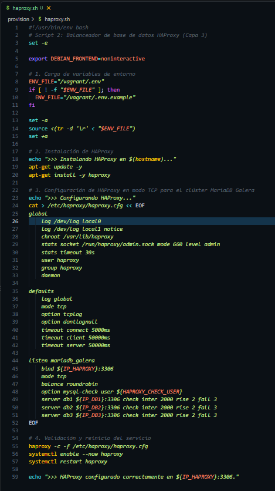

### **_2.3 Servidor NFS y PHP-FPM (`nfs_php.sh`)_**

Despliega **WordPress** mediante **WP-CLI** en **`serverNFSAmparo`** (`192.168.10.20`), exporta `/var/www/html` por **NFS** y sirve **PHP-FPM** por **TCP**:

<details>
  <summary>
    <strong>
      Ver código <code>nfs_php.sh</code>
    </strong>
  </summary>

```bash
#!/usr/bin/env bash
# Script 3: Servidor NFS, PHP-FPM (TCP) y WordPress con WP-CLI (Capa 2)
set -e

export DEBIAN_FRONTEND=noninteractive

# 1. Carga de variables de entorno
ENV_FILE="/vagrant/.env"
if [ ! -f "$ENV_FILE" ]; then
  ENV_FILE="/vagrant/.env.example"
fi

set -a
source <(tr -d '\r' < "$ENV_FILE")
set +a

WP_PATH="/var/www/html"

# 2. Instalación de NFS Server, PHP-FPM, extensiones de WordPress y cliente MariaDB
echo ">>> Instalando NFS Server, PHP-FPM y dependencias en $(hostname)..."
apt-get update -y
apt-get install -y \
  nfs-kernel-server \
  mariadb-client \
  php-fpm \
  php-cli \
  php-mysql \
  php-curl \
  php-gd \
  php-intl \
  php-mbstring \
  php-soap \
  php-xml \
  php-zip \
  curl \
  unzip

# 3. Configuración de PHP-FPM por socket TCP restringido a los dos servidores web
echo ">>> Configurando PHP-FPM en ${IP_NFS}:9000..."
PHP_POOL="/etc/php/8.2/fpm/pool.d/www.conf"
PHP_INI="/etc/php/8.2/fpm/php.ini"

sed -i "s|^listen = .*|listen = ${IP_NFS}:9000|" "$PHP_POOL"
if grep -q "^;\?listen.allowed_clients" "$PHP_POOL"; then
  sed -i "s|^;\?listen.allowed_clients = .*|listen.allowed_clients = ${IP_WEB1},${IP_WEB2}|" "$PHP_POOL"
else
  echo "listen.allowed_clients = ${IP_WEB1},${IP_WEB2}" >> "$PHP_POOL"
fi

sed -i 's/^;\?cgi\.fix_pathinfo=.*/cgi.fix_pathinfo=0/' "$PHP_INI"
sed -i 's/^upload_max_filesize\s*=.*/upload_max_filesize = 64M/' "$PHP_INI"
sed -i 's/^post_max_size\s*=.*/post_max_size = 64M/' "$PHP_INI"

systemctl enable --now php8.2-fpm
systemctl restart php8.2-fpm

# 4. Instalación de WP-CLI y despliegue de WordPress conectado a HAProxy
echo ">>> Instalando WP-CLI y configurando WordPress..."
mkdir -p "$WP_PATH"

if ! command -v wp >/dev/null 2>&1; then
  curl -sSL https://raw.githubusercontent.com/wp-cli/builds/gh-pages/phar/wp-cli.phar -o /usr/local/bin/wp
  chmod +x /usr/local/bin/wp
fi

if [ ! -f "$WP_PATH/wp-includes/version.php" ]; then
  wp core download --path="$WP_PATH" --allow-root
fi

if [ ! -f "$WP_PATH/wp-config.php" ]; then
  wp config create \
    --path="$WP_PATH" \
    --dbname="$DB_NAME" \
    --dbuser="$DB_USER" \
    --dbpass="$DB_PASS" \
    --dbhost="${IP_HAPROXY}:3306" \
    --locale="$WP_LOCALE" \
    --allow-root

  # Ajustes para trabajar detrás de un balanceador de carga (proxy inverso)
  wp config set WP_HOME "$WP_URL" --path="$WP_PATH" --allow-root
  wp config set WP_SITEURL "$WP_URL" --path="$WP_PATH" --allow-root
fi

if ! wp core is-installed --path="$WP_PATH" --allow-root; then
  wp core install \
    --path="$WP_PATH" \
    --url="$WP_URL" \
    --title="$WP_TITLE" \
    --admin_user="$WP_ADMIN_USER" \
    --admin_password="$WP_ADMIN_PASS" \
    --admin_email="$WP_ADMIN_EMAIL" \
    --skip-email \
    --allow-root
fi

wp language core install "$WP_LOCALE" --activate --path="$WP_PATH" --allow-root || true
wp rewrite structure '/%postname%/' --path="$WP_PATH" --allow-root
wp rewrite flush --path="$WP_PATH" --allow-root

# Tema personalizado distinto al de por defecto
if ! wp theme is-installed "$WP_THEME" --path="$WP_PATH" --allow-root; then
  wp theme install "$WP_THEME" --activate --path="$WP_PATH" --allow-root
else
  wp theme activate "$WP_THEME" --path="$WP_PATH" --allow-root
fi

# Entrada propia inicial
if [ -z "$(wp post list --post_type=post --name=bienvenida-ha --format=ids --path="$WP_PATH" --allow-root)" ]; then
  wp post create \
    --post_type=post \
    --post_title="Despliegue en Alta Disponibilidad de 4 capas" \
    --post_name="bienvenida-ha" \
    --post_content="Entrada inicial generada automáticamente sobre la infraestructura LEMP en Alta Disponibilidad con MariaDB Galera, HAProxy, NFS y Nginx." \
    --post_status=publish \
    --path="$WP_PATH" \
    --allow-root
fi

# Propietario y permisos correctos (www-data)
chown -R www-data:www-data "$WP_PATH"
find "$WP_PATH" -type d -exec chmod 755 {} \;
find "$WP_PATH" -type f -exec chmod 644 {} \;
chmod 640 "$WP_PATH/wp-config.php"

# 5. Exportación por NFS únicamente a los dos servidores web con root_squash
echo ">>> Configurando exportación NFS en /etc/exports..."
echo "${WP_PATH} ${IP_WEB1}(rw,sync,no_subtree_check,root_squash) ${IP_WEB2}(rw,sync,no_subtree_check,root_squash)" > /etc/exports

exportfs -ra
systemctl enable --now nfs-kernel-server
systemctl restart nfs-kernel-server

echo ">>> Servidor NFS, PHP-FPM y WordPress configurados correctamente."
```

> **EXPLICACIÓN DEL CÓDIGO**
> ---
> - **PHP-FPM por TCP**: Escucha en `192.168.10.20:9000` aceptando peticiones solo de `serverweb1Amparo` y `serverweb2Amparo`.
> - **WordPress + WP-CLI**: Conecta a la BD vía `192.168.10.30:3306`, fija `WP_HOME`/`WP_SITEURL` a `http://localhost:8080`, activa el tema `astra` y crea la entrada inicial.
> - **NFS (`/etc/exports`)**: Comparte `/var/www/html` solo con ambos servidores web usando `root_squash`.
> - **Idempotencia**: Comprueba la existencia previa de WordPress, tema y entrada antes de crearlos.

</details>

---

| | |
| --- | --- |
| 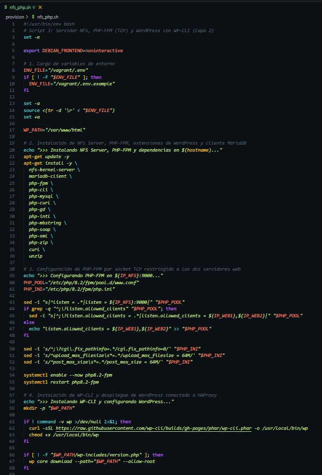 | 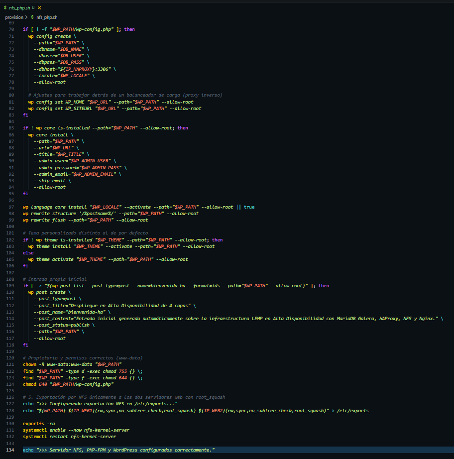 |

### **_2.4 Servidores web Nginx (`web.sh`)_**

Configura **`serverweb1Amparo`** y **`serverweb2Amparo`** montando **WordPress** por **NFS** y enviando el código **PHP** a **`serverNFSAmparo`**:

<details>
  <summary>
    <strong>
      Ver código <code>web.sh</code>
    </strong>
  </summary>

```bash
#!/usr/bin/env bash
# Script 4: Servidores web Nginx + cliente NFS (Capa 2)
set -e

export DEBIAN_FRONTEND=noninteractive

# 1. Carga de variables de entorno
ENV_FILE="/vagrant/.env"
if [ ! -f "$ENV_FILE" ]; then
  ENV_FILE="/vagrant/.env.example"
fi

set -a
source <(tr -d '\r' < "$ENV_FILE")
set +a

WP_PATH="/var/www/html"
SERVER_NAME_ID="$(hostname)"

# 2. Instalación de Nginx y cliente NFS
echo ">>> Instalando Nginx y cliente NFS en ${SERVER_NAME_ID}..."
apt-get update -y
apt-get install -y nginx nfs-common

# 3. Montaje persistente de WordPress por NFS (idempotente)
echo ">>> Montando ${IP_NFS}:${WP_PATH} en ${WP_PATH}..."
mkdir -p "$WP_PATH"

FSTAB_LINE="${IP_NFS}:${WP_PATH} ${WP_PATH} nfs defaults,_netdev 0 0"
if ! grep -qs "^${IP_NFS}:${WP_PATH} " /etc/fstab; then
  echo "$FSTAB_LINE" >> /etc/fstab
fi

mountpoint -q "$WP_PATH" || mount -a

# 4. Configuración de Nginx (PHP-FPM remoto por TCP, IP real y cabecera de hostname)
echo ">>> Configurando Nginx en ${SERVER_NAME_ID}..."
echo "client_max_body_size 64M;" > /etc/nginx/conf.d/uploads.conf

cat > /etc/nginx/sites-available/default << EOF
server {
    listen 80 default_server;
    listen [::]:80 default_server;

    root ${WP_PATH};
    index index.php index.html index.htm;
    server_name _;

    # Registrar en los logs la IP real del visitante y no la del balanceador
    set_real_ip_from ${IP_LB};
    real_ip_header X-Forwarded-For;
    real_ip_recursive on;

    # Cabecera HTTP indicando qué servidor web atiende la petición
    add_header X-Served-By "${SERVER_NAME_ID}" always;

    location / {
        try_files \$uri \$uri/ /index.php?\$args;
    }

    location ~ \.php\$ {
        include snippets/fastcgi-php.conf;
        fastcgi_pass ${IP_NFS}:9000;
    }

    location ~ /\.ht {
        deny all;
    }
}
EOF

# 5. Validación y reinicio de Nginx
nginx -t
systemctl enable --now nginx
systemctl restart nginx

echo ">>> Servidor web ${SERVER_NAME_ID} configurado correctamente."
```

> **EXPLICACIÓN DEL CÓDIGO**
> ---
> - **NFS en `/etc/fstab`**: Montaje persistente con `_netdev` (idempotente mediante `grep` y `mountpoint`).
> - **`fastcgi_pass ${IP_NFS}:9000`**: Delega PHP al socket TCP de `serverNFSAmparo`.
> - **`set_real_ip_from` y `X-Forwarded-For`**: Registra en los logs la IP real del visitante en lugar de la del balanceador.
> - **`add_header X-Served-By`**: Identifica en la respuesta qué servidor web ha atendido la petición.

</details>

---

| | |
| --- | --- |
| 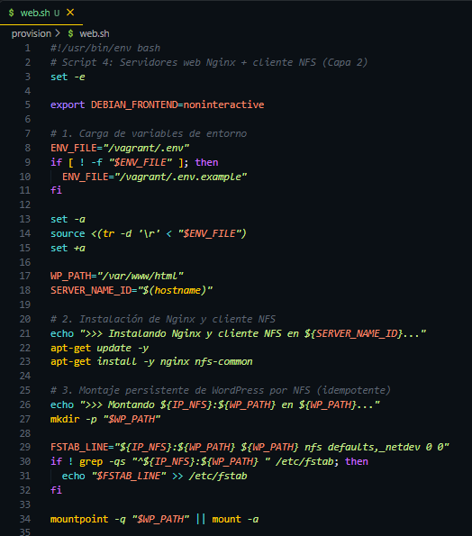 | 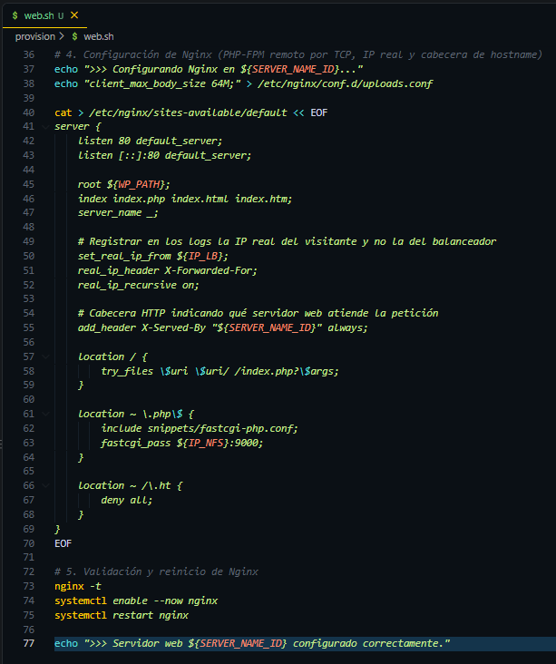 |

### **_2.5 Balanceador de carga Nginx (`balanceador.sh`)_**

Configura **`balanceadorAmparo`** (`192.168.10.10`, puerto `8080`) como proxy inverso y balanceador de carga entre ambos servidores web:

<details>
  <summary>
    <strong>
      Ver código <code>balanceador.sh</code>
    </strong>
  </summary>

```bash
#!/usr/bin/env bash
# Script 5: Balanceador de carga Nginx (Capa 1 - Único punto de entrada)
set -e

export DEBIAN_FRONTEND=noninteractive

# 1. Carga de variables de entorno
ENV_FILE="/vagrant/.env"
if [ ! -f "$ENV_FILE" ]; then
  ENV_FILE="/vagrant/.env.example"
fi

set -a
source <(tr -d '\r' < "$ENV_FILE")
set +a

# 2. Instalación de Nginx
echo ">>> Instalando Nginx en $(hostname)..."
apt-get update -y
apt-get install -y nginx

# 3. Formato de log personalizado con el servidor backend elegido ($upstream_addr)
echo ">>> Configurando formato de log y límite de subida..."
cat > /etc/nginx/conf.d/lb_logging.conf <<'EOF'
log_format upstream_log '$remote_addr - [$time_local] "$request" '
                        '$status $body_bytes_sent '
                        'upstream="$upstream_addr" '
                        'rt=$request_time';

client_max_body_size 64M;
EOF

# 4. Configuración del upstream y proxy inverso hacia serverweb1 y serverweb2
echo ">>> Configurando balanceo de carga en Nginx..."
cat > /etc/nginx/sites-available/default <<EOF
upstream wordpress_backend {
    server ${IP_WEB1}:80 max_fails=2 fail_timeout=10s;
    server ${IP_WEB2}:80 max_fails=2 fail_timeout=10s;
}

server {
    listen 80 default_server;
    listen [::]:80 default_server;

    server_name _;

    access_log /var/log/nginx/access.log upstream_log;

    location / {
        proxy_pass http://wordpress_backend;
        proxy_next_upstream error timeout invalid_header http_500 http_502 http_503 http_504;

        # Cabeceras necesarias para WordPress y para registrar la IP real en los backends
        proxy_set_header Host \$http_host;
        proxy_set_header X-Real-IP \$remote_addr;
        proxy_set_header X-Forwarded-For \$proxy_add_x_forwarded_for;
        proxy_set_header X-Forwarded-Proto \$scheme;
    }
}
EOF

# 5. Validación y reinicio de Nginx
nginx -t
systemctl enable --now nginx
systemctl restart nginx

echo ">>> Balanceador Nginx configurado correctamente."
```

> **EXPLICACIÓN DEL CÓDIGO**
> ---
> - **`upstream wordpress_backend`**: Reparte tráfico entre `192.168.10.21` y `192.168.10.22`; con `max_fails=2 fail_timeout=10s` y `proxy_next_upstream`, aísla automáticamente el nodo caído.
> - **`upstream_log`**: Registra `$upstream_addr` en `/var/log/nginx/access.log`.
> - **`Host $http_host` y `X-Forwarded-For`**: Conservan el puerto `8080` y reenvían la IP real del cliente.

</details>

---

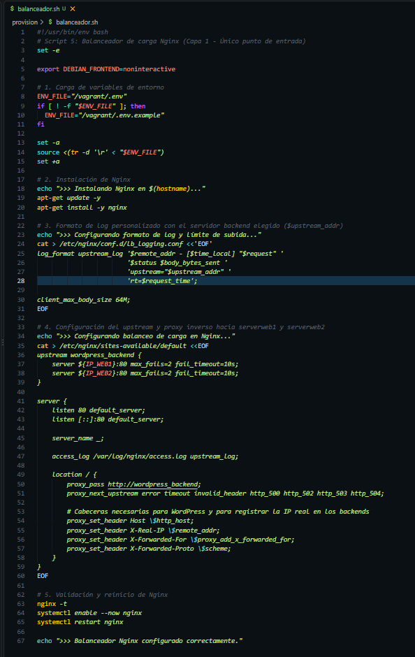

---

## **_3. Despliegue y comprobaciones_**

### **_3.1 Despliegue de la infraestructura_**

Con **`.env`** configurado, levantamos las 8 máquinas y comprobamos su estado y puertos expuestos:

```bash
vagrant up
vagrant status
vagrant port balanceadorAmparo
```

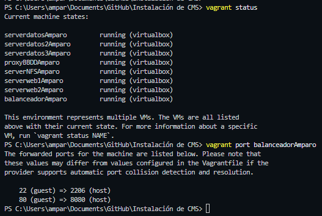

### **_3.2 Comprobaciones_**

**1. Conectividad interna**

Comprobamos mediante **`ping`** la comunicación entre las 8 máquinas en `192.168.10.10`–`192.168.10.43`:

```powershell
$vms = "serverdatosAmparo","serverdatos2Amparo","serverdatos3Amparo","proxyBBDDAmparo","serverNFSAmparo","serverweb1Amparo","serverweb2Amparo","balanceadorAmparo"
foreach ($m in $vms) {
  Write-Host "=== $m ===" -ForegroundColor Cyan
  vagrant ssh $m -c 'for ip in 10 20 21 22 30 41 42 43; do ping -c 1 -W 1 192.168.10.$ip >/dev/null && echo 192.168.10.$ip OK || echo 192.168.10.$ip FAIL; done'
}
```

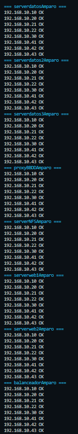

**2. Montaje NFS y PHP-FPM**

Verificamos el montaje **`/var/www/html`** en ambos servidores web y el puerto **`192.168.10.20:9000`** en **`serverNFSAmparo`**:

```bash
# En serverweb1Amparo y serverweb2Amparo
df -h | grep /var/www/html

# En serverNFSAmparo
sudo ss -tlnp | grep 9000
```

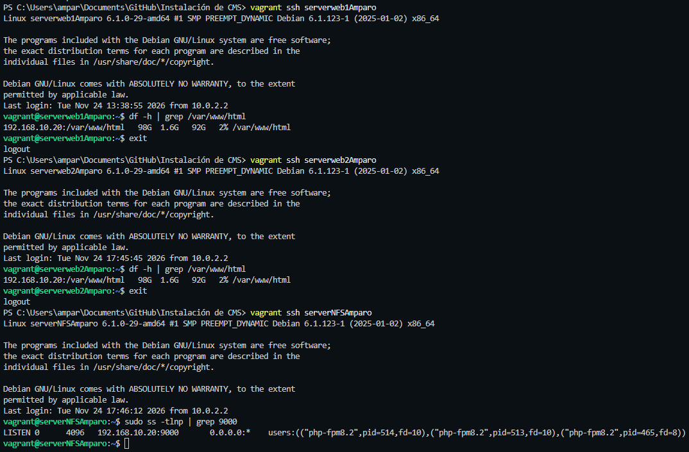

**3. Estado del clúster Galera**

Comprobamos en los tres nodos que el clúster muestra **`3`**, **`Primary`** y **`Synced`**:

```bash
# En serverdatosAmparo, serverdatos2Amparo y serverdatos3Amparo
sudo mariadb -e "SHOW STATUS WHERE Variable_name IN ('wsrep_cluster_size','wsrep_cluster_status','wsrep_local_state_comment');"
```

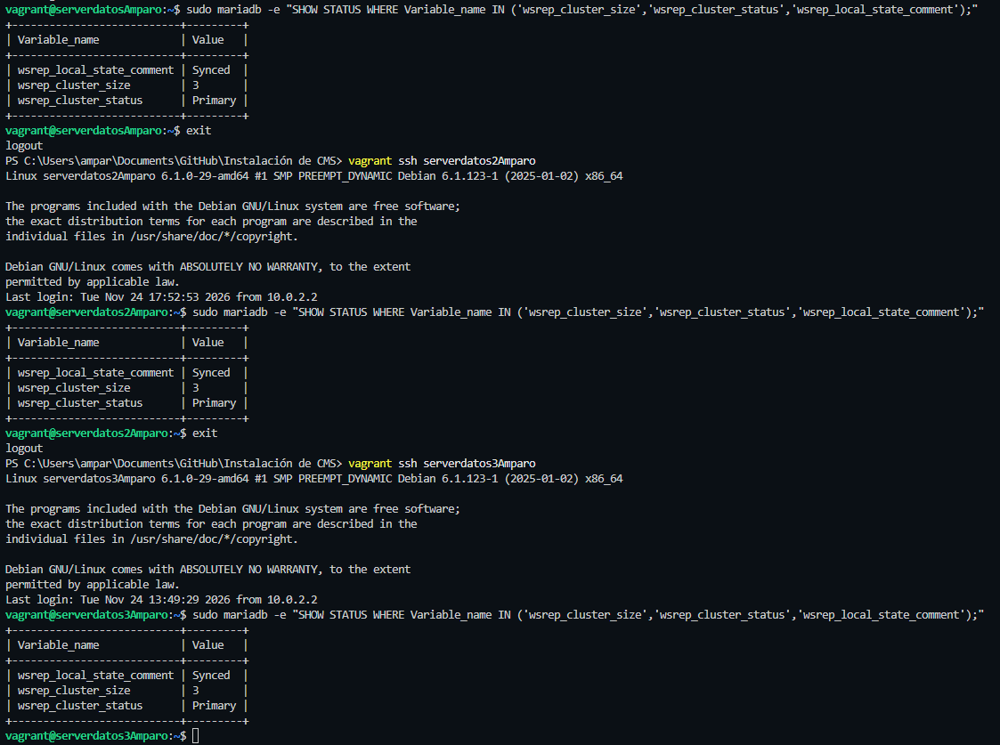

**4. HAProxy y restricción de acceso**

Desde **`serverNFSAmparo`**, comprobamos la rotación de los 3 nodos vía **`192.168.10.30`** y el bloqueo del acceso directo a **`192.168.10.41`** (`ERROR 1130`):

```bash
# Desde serverNFSAmparo
set -a && source <(tr -d '\r' < /vagrant/.env) && set +a
for i in 1 2 3 4 5 6; do mariadb -h 192.168.10.30 -u "$DB_USER" -p"$DB_PASS" -Nse "SELECT @@hostname;"; done
mariadb -h 192.168.10.41 -u "$DB_USER" -p"$DB_PASS" -e "SELECT @@hostname;"
```

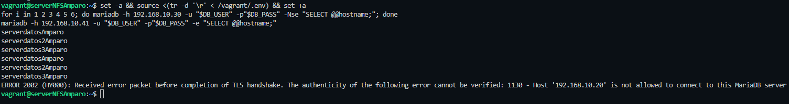

**5. Acceso a WordPress, balanceo web y logs**

Verificamos el acceso a **`http://localhost:8080`**, la alternancia de **`X-Served-By`** y los logs de **`balanceadorAmparo`**:

```powershell
# Desde el anfitrión
1..6 | ForEach-Object { (curl.exe -sI http://localhost:8080 | Select-String "X-Served-By") }
```

```bash
# En balanceadorAmparo
sudo tail -n 10 /var/log/nginx/access.log
```

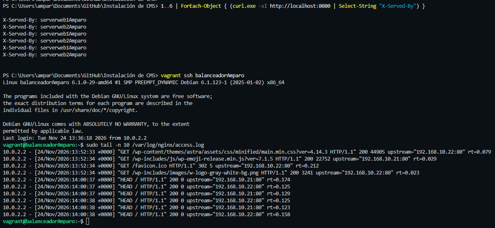

**6. Sincronización de archivos por NFS**

Subimos una imagen en **`http://localhost:8080/wp-admin/`** y comprobamos que aparece al instante en ambos servidores web:

```powershell
vagrant ssh serverweb1Amparo -c "ls -laR /var/www/html/wp-content/uploads/"
vagrant ssh serverweb2Amparo -c "ls -laR /var/www/html/wp-content/uploads/"
```

| | |
| --- | --- |
| 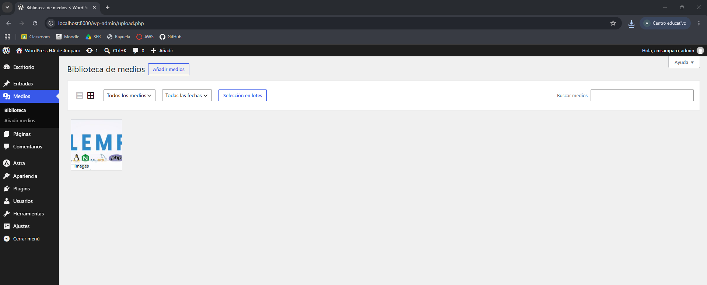 | 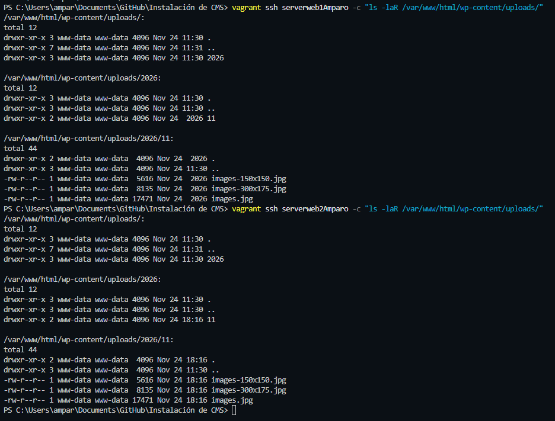 |

**7. Tolerancia a fallos en capa web**

Apagamos **`serverweb1Amparo`** para verificar que **`serverweb2Amparo`** asume todo el tráfico y que al arrancar de nuevo vuelve a balancear:

```powershell
vagrant halt serverweb1Amparo
1..4 | ForEach-Object { (curl.exe -sI http://localhost:8080 | Select-String "X-Served-By") }

vagrant up serverweb1Amparo
1..6 | ForEach-Object { (curl.exe -sI http://localhost:8080 | Select-String "X-Served-By") }
```

| | |
| --- | --- |
| 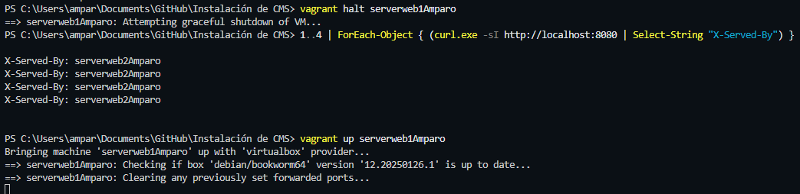 | 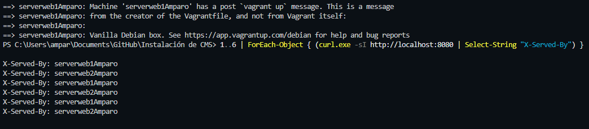 |

**8. Replicación y caída en Galera**

Publicamos una entrada en **`http://localhost:8080/wp-admin/`** y verificamos su replicación en los 3 nodos:

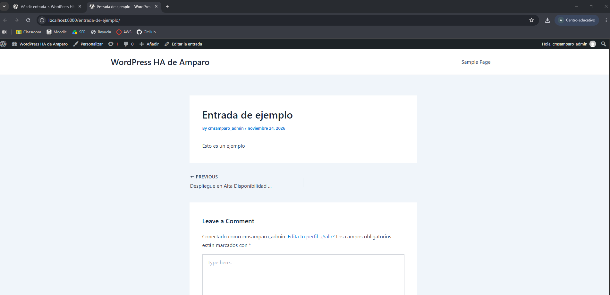

```bash
# En serverdatosAmparo, serverdatos2Amparo y serverdatos3Amparo (vía vagrant ssh)
sudo mariadb wordpress -e "SELECT ID, post_title, post_status FROM wp_posts WHERE post_type='post';"
```

Apagamos **`serverdatos3Amparo`**, comprobamos que **WordPress** sigue operativo y publicamos una segunda entrada:

```powershell
vagrant halt serverdatos3Amparo
```

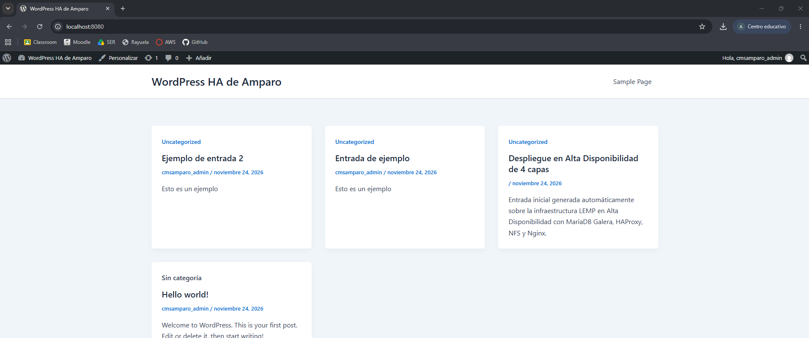

Volvemos a arrancar el nodo 3 y comprobamos que se resincroniza (`3` / `Synced`) con la nueva entrada ya replicada:

```powershell
vagrant up serverdatos3Amparo
```

```bash
# En serverdatos3Amparo (vía vagrant ssh)
sudo mariadb -e "SHOW STATUS WHERE Variable_name IN ('wsrep_cluster_size','wsrep_local_state_comment');"
sudo mariadb wordpress -e "SELECT ID, post_title, post_status FROM wp_posts WHERE post_type='post';"
```

| | |
| --- | --- |
| 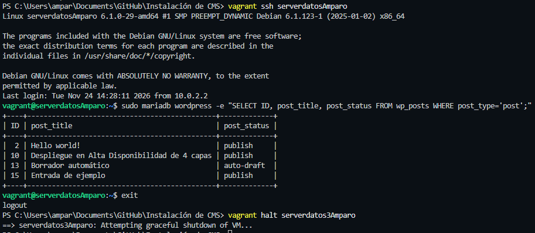 | 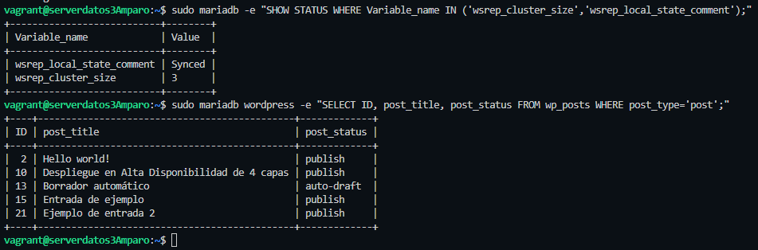 |

---

## **_4. Volver a arrancar Galera tras un apagado_**

Tras un apagado completo (**`vagrant halt`**), **Galera** bloquea el arranque automático para evitar *split-brain*: debemos indicar qué nodo inicializa el clúster (**bootstrap**) y unir después los otros dos.

**1. Levantar las máquinas:**

```powershell
vagrant up
```

**2. Comprobar `grastate.dat` en los tres nodos:**

```powershell
foreach ($m in "serverdatosAmparo","serverdatos2Amparo","serverdatos3Amparo") {
  Write-Host "=== $m ===" -ForegroundColor Cyan
  vagrant ssh $m -c "sudo cat /var/lib/mysql/grastate.dat"
}
```

Elegimos el nodo con **`safe_to_bootstrap: 1`** (**`serverdatosAmparo`**). Si los tres estuvieran a **`0`**, se elige el de mayor **`seqno`** —o `serverdatosAmparo` si coinciden— y se cambia a **`1`**.

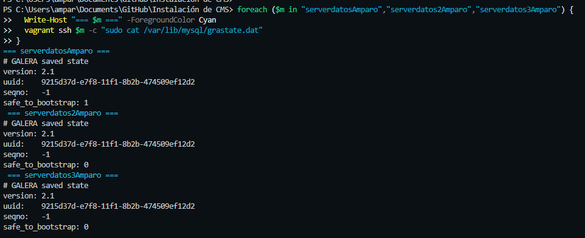

**3. Inicializar el clúster y unir el resto de nodos:**

```powershell
# Inicializar en el nodo bootstrap
vagrant ssh serverdatosAmparo -c "sudo systemctl stop mariadb; sudo galera_new_cluster"

# Unir el resto de nodos uno tras otro
vagrant ssh serverdatos2Amparo -c "sudo systemctl start mariadb"
vagrant ssh serverdatos3Amparo -c "sudo systemctl start mariadb"
```


**4. Verificar el estado (`3`, `Primary` y `Synced`):**

```powershell
vagrant ssh serverdatosAmparo -c "sudo mariadb -e 'SHOW STATUS' | grep -E 'wsrep_cluster_size|wsrep_cluster_status|wsrep_local_state_comment'"
```

> **Nota:** Si **HAProxy** mantuviera algún nodo caído, ejecutar `sudo systemctl restart haproxy` en **`proxyBBDDAmparo`**.

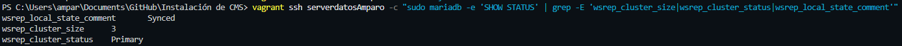

---

## **_5. Screencast_**

[Enlace al screencast](screencast/Instalacion%20CMS%20alta%20disponibilidad.mp4)

---

## **_6. Incidencias_**

**Pérdida del puerto `:8080` al acceder a `/wp-admin`**

Al entrar en **`http://localhost:8080/wp-admin`**, el navegador redirigía a **`http://localhost/wp-admin/`** devolviendo `ERR_CONNECTION_REFUSED`.

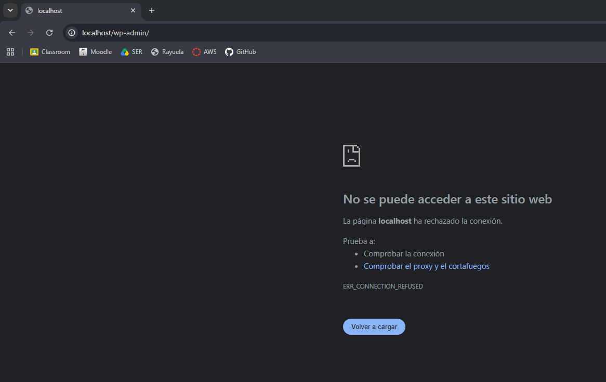

- **Causa:** Sin la barra final (**`/`**), **Nginx** detectó un directorio y generó una redirección absoluta hacia su puerto interno (**`80`**), perdiendo el **`:8080`** del balanceador.
- **Solución:** Acceder con la barra final (**`http://localhost:8080/wp-admin/`**) o por **`http://localhost:8080/wp-login.php`** (de forma permanente, añadiendo `absolute_redirect off;` en `provision/web.sh`).

---

## **_7. Fuentes consultadas_**

- **[MariaDB Galera Cluster](https://mariadb.com/docs/galera-cluster)**
- **[Pledin — José Domingo Muñoz](https://www.josedomingo.org/pledin/)**
- **[DigitalOcean Tutorials](https://www.digitalocean.com/community/tutorials)**
- **[Documentación oficial de HAProxy](https://www.haproxy.org/)**
- **[Documentación oficial de Nginx](https://nginx.org/en/docs/)**
- **[Manual oficial de PHP-FPM](https://www.php.net/manual/es/install.fpm.php)**
- **[Documentación oficial de WP-CLI](https://wp-cli.org/)**
- **[Documentación oficial de Vagrant](https://developer.hashicorp.com/vagrant/docs)**